  

# china-state-vessels

An open, sourced list of Chinese state-linked vessels for journalists and researchers: research and survey ships,
PLA intelligence, tracking and survey ships, China Coast Guard ships, and boats that named sources identify as
China's maritime militia. Every row cites its sources and has a date checked; every filled field was researched
against a source and then fact-checked; militia rows name who made the identification.

**[data/vessels.csv](data/vessels.csv)**: 85 vessels, first release, checked 25 November 2026. Also on
[Hugging Face](https://huggingface.co/datasets/OSINT-JOURNO/china-state-vessels), where you can sort and filter it in the browser.

| Group | Vessels | Notes |
|---|---|---|
| Research and survey (`research`, `survey`) | 19 | Ministry of Natural Resources, China Geological Survey, Chinese Academy of Sciences, university and other state-owned ships (including a CNOOC subsidiary and a Hainan provincial ship), with port calls and surveys that made news |
| PLA ships (`intelligence`, `space_tracking`, `navy_survey`) | 16 | Dongdiao-class intelligence ships, Yuan Wang tracking ships, Shupang-class survey ships; sightings and port calls reported by Japan's Ministry of Defense and Joint Staff Office, the Philippines, Australia, Sri Lanka and India |
| China Coast Guard (`coast_guard`) | 21 | Cutters named in incidents with the Philippines, Japan, Vietnam, Indonesia and Taiwan, with each side's account where one was given |
| Maritime militia (`militia`) | 29 | All "assessed": identified by CSIS AMTI, the Philippine Coast Guard or the Philippine government, or documented by Erickson and Martinson. The dataset never states militia status as its own finding; `confidence` rates how well the identification is sourced, not whether the boat is militia |

- 30 vessels have an MMSI; 23 of them are confirmed in the ITU's official ship station register (ITU MARS), three
  under a variant or former name. The other 7 are militia boats, whose MMSIs come from CSIS AMTI's published table.
- 32 have the Chinese name, only where a source shows the characters. 33 have a hull or pennant number.
- Most coast guard and navy ships have no public MMSI or IMO number, and most militia boats run with AIS off. Blank
  means "not established from a public source", never "none".

## The columns

| Column | What it holds |
|---|---|
| `id` | Stable ID: `CNV-R` research and survey, `CNV-N` PLA, `CNV-C` coast guard, `CNV-M` militia |
| `name_en`, `name_zh`, `former_names` | Names as the sources write them |
| `category` | `research`, `survey`, `space_tracking`, `intelligence`, `navy_survey`, `coast_guard`, `militia` |
| `hull_number`, `imo`, `mmsi`, `call_sign`, `flag` | Identifiers, each with its source in `identifier_sources` |
| `operator`, `home_port`, `type_or_class`, `built_year` | As far as the sources establish them |
| `notable_activity` | One dated event, in the words of a named source |
| `label_source`, `label_tier` | Who identified the vessel's role, when, and how firmly (see [METHOD.md](METHOD.md)); blank for civilian research and survey ships and the tracking ships |
| `confidence`, `confidence_reason` | How solid the row is, and why |
| `registry_check` | What the ITU register showed |
| `sources`, `identifier_sources` | The source URLs |
| `last_checked` | When the row was last checked |

## How it was built

Each row was researched with a source for every filled field, then checked by a separate, independent fact-check
against those sources. Three rows that could not be supported were left out of this release: a boat identified only
from a partly visible bow number, a survey ship with no state link, and a coast guard cutter reported only as present
nearby. `tools/build.py` then refuses any row that breaks the rules it can check (no source URL, an unattributed
militia label, a malformed MMSI, an IMO number that fails its check digit, a duplicate, a citation of a tracking site
whose terms forbid datasets). The working files it builds from (research notes, rejected rows, and source tables we
cite but do not republish) are not published. The full standard is in [METHOD.md](METHOD.md).

The banner at the top is drawn from the CSV by `tools/make_banner.py` (an animated SVG with no scripts or trackers), and
a test fails if the banner, its alt text or the vessel count above ever stop matching the data. Each tick in its ring is one vessel; it is a count, not a map.

`tools/itu_mars.py` looks a ship up in the ITU register. It waits 8 seconds between searches and caches results:
the register refuses requests that come too fast.

## Using it

- Read `label_source` and `confidence` before quoting a row. "Assessed" means a named source identified the vessel;
  say who.
- Identifiers go stale: ships are renamed, renumbered and sold, and MMSIs are reused or spoofed. Check
  `last_checked`, and check the identifier yourself before relying on it in a story.
- The South China Sea incidents are contested. The rows say whose account each one is.
- To map a vessel's track from AIS data you have the rights to use, see
  [osint-visuals](https://github.com/Ghongha007/osint-visuals) (`track-map`).

## Main sources

CSIS Asia Maritime Transparency Initiative (militia and survey-ship reporting, including the Hainan militia table
published with *Behind the Curtain*, 12 December 2024), the Philippine Coast Guard and the National Task Force for
the West Philippine Sea, Japan's Ministry of Defense and Joint Staff Office, Australia's Department of Defence,
Indonesia's Bakamla, Taiwan's Coast Guard Administration, the US Naval War College China Maritime Studies Institute,
the ITU ship station register, the NERC/ICES ship-code list, Wikipedia (only where nothing better exists, and flagged
in `confidence_reason`), Chinese official and state media, and news reports cited row by row. This dataset reproduces
facts with attribution, not those sources' text or tables; for AMTI's full list of Hainan vessels, see their article.

## Corrections

Open an issue with the vessel ID and a source. See [CORRECTIONS.md](CORRECTIONS.md).

## What this is not

- Not a list of every Chinese state vessel: it lists what has been documented publicly.
- Not a finding by OSINT JOURNO that any boat is militia: every such label is someone else's, cited.
- Not a source of positions or tracks.

## Licence

Data: [CC BY 4.0](LICENSE-DATA.md), credit "China state-linked vessels dataset, OSINT JOURNO". Scripts: MIT
([LICENSE](LICENSE)). Made by [OSINT JOURNO](https://github.com/OSINT-JOURNO).

## Related

- [china-osint](https://github.com/Ghongha007/china-osint): public records and open data for investigating China
- [osint-visuals](https://github.com/Ghongha007/osint-visuals): evidence graphics, including animated ship tracks that flag signal gaps
- [osint-skills](https://github.com/Ghongha007/osint-skills): agent skills for verification
